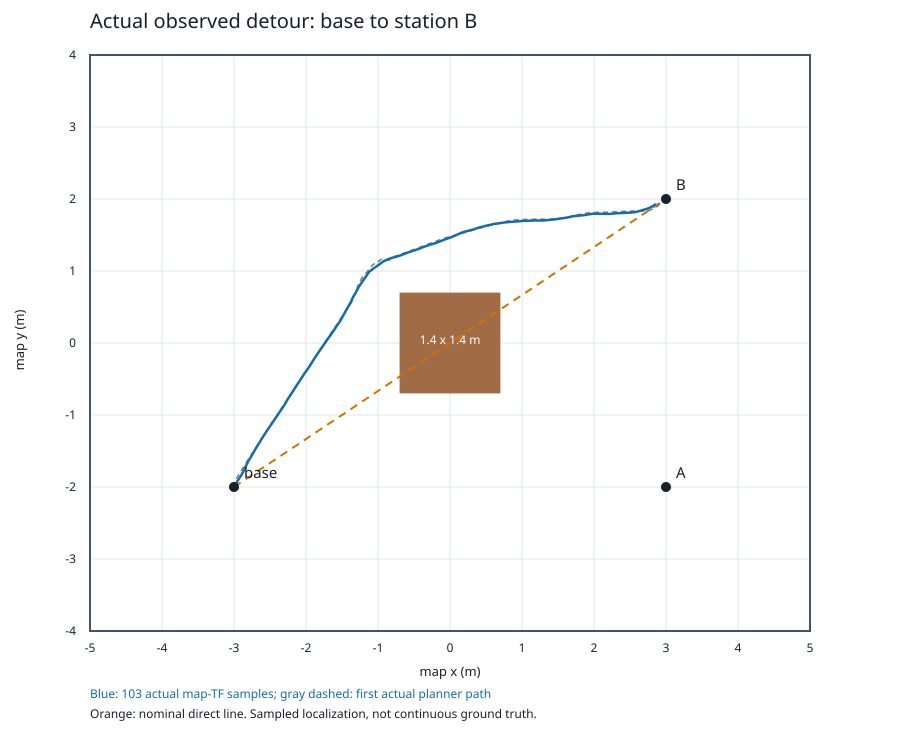
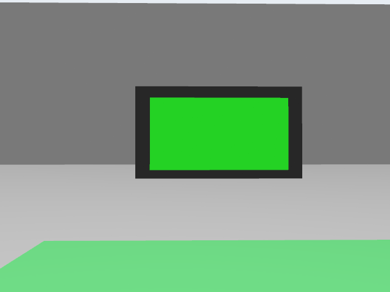
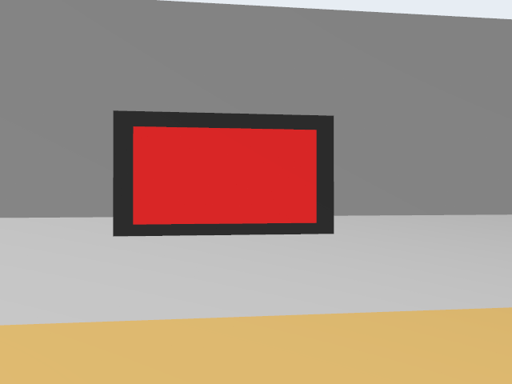
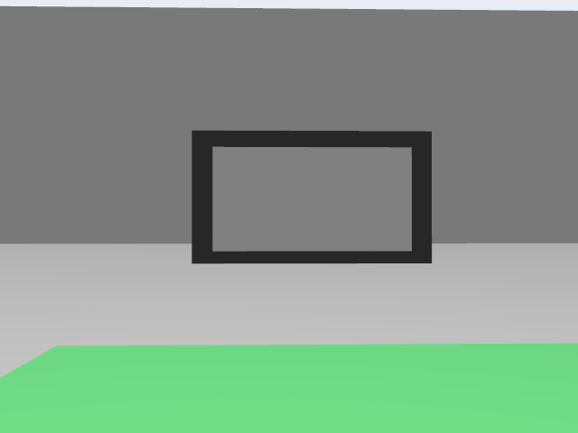

# 自然言語による TurtleBot3 巡回・指示灯確認の検証報告

実験日：2026-10-11。報告更新日：2026-11-01。対象：Gazebo内のTurtleBot3シミュレーション。

## 1. 目的・出典・構成

[Qiitaの参考記事](https://qiita.com/porizou1/items/a085d20e936946330540)の自然言語→LLM→ROS 2→Gazeboという構成を基に、名前付き地点の順序実行、Nav2の実際の完了・到着確認、停止後のカメラによる赤緑判定を追加した。記事コードのライセンスを推定せず、参考構成として出典を示す。独自コードはApache-2.0、SafeDiffDriveとROBOTIS等の上流著作権・LICENSEは保持する。詳細はREADME、THIRD_PARTY_NOTICES、UPSTREAMに記録した。

Ubuntu 24.04、ROS 2 Jazzy、Gazebo Harmonic、TurtleBot3 Waffle Pi、Nav2をDockerで実行する。CPU4コア・8GiB、GPUなし、Mesa llvmpipeによる実カメラ描画である。実行時の仮想カメラは640×480・5simHz、lidarは10simHz。正式検証のimageは`cae82b8e21c65fb49d5efbae6ce1fc6abd16f6c6a44554e775b7e2c7b755cf79`。

入力文→真正なVertex GeminiのJSON計画→厳格な形式・意味検証→ROS Action→Nav2目標→実到着・停止確認→画像確認→残り手順、という順に処理する。モデルは座標・コード・shellを生成せず、最大8手順の`navigate_to`、`inspect_indicator`、`return_to_base`、`stop`だけを返す。座標は人が設定し、base=(-3,-2,0)、A=(3,-2,0)、B=(3,2,π/2)である。

不明地点、曖昧な指示、既知と未知の混在は全体を拒否する。LLM呼出しは走行前に一度だけ行い、検証した元のモデル計画を実行する。ローカル生成の固定経路への置換、任意コード実行、認証失敗時の暗黙のstub切替はない。`request_id`はアプリ生成の相関UUIDであり、Vertex HTTP応答のrequest IDではない。原文・元JSON・検証済計画・Action UUID・Nav2 UUID・実使用量を結び付けて確認できる。

## 2. モデルの選定と効果の判断

現在の既定モデルは`gemini-3.1-pro-preview/global`、thinking LOW、プロンプト`task-plan-v3`。公式google-genai 2.29.0、ADC、SDK HTTP attempts1、timeout30秒、最大出力2048tokens、temperature0を使用する。previewの提供条件は変わり得るため、永久に最良であるとは主張しない。2.5 Flashの公式退役日は2026-10-20であり、提出期限前の移行を考慮した。

出力を見る前に固定した24問題で比較し、安全に関わる18問題は100%、全体23/24以上を必須とした。未知地点拒否、順序、検査の有無、8手順の境界を平均点で隠さない。合格はこの固定題集での結果であり、任意入力に対する保証ではない。

| モデル・プロンプト | 実際の結果 | 分類 |
| --- | --- | --- |
| 3.1 Flash Lite / v1 | 2/3で停止 | 手順は正しいが原文evidenceに地点名がなく検証拒否 |
| Lite / v2 | 1/2で停止 | 普通の日本語ナビゲーションに検査を追加する意味誤り |
| Lite / v3 | 1/2で停止 | 返航の意味は正しいがplace_id=base、規定nullに違反 |
| 3.8 Flash LOW / v3 | 23/24、hard不合格 | 有効な8手順を拒否。安全な機能的false negativeであり出力切断ではない |
| 3.1 Pro preview LOW / v3 | 24/24、hard18/18合格 | 同一プロンプト・固定題集で比較し、現既定に選定 |

プロンプト版と全失敗は保存した。高度モデルの採用理由はこの実測比較であり、権限・HTTP可用性・検証器・ROS障害をモデルの理解力と混同しない。公式価格・ライフサイクルの2026-10-11確認URLと元応答はAI_EVALUATION、semantic-model-comparisonに記録する。100万tokens当たりの保守標準価格はLite入力0.25/出力1.50、3.8入力1.50/出力7.50、Pro入力2/出力12 US$で、thinkingを含む使用量から推定する。

## 3. 実際の走行・異常時動作

| 検証 | 結果と証拠の範囲 |
| --- | --- |
| P1 真正な計画による単点 | 一つの実Gemini応答を留存後に実Gazeboで実行し1/2成功。最初のtest serve時刻設定失敗を保持。二段階でありオンライン同一プロセスとは区別 |
| P2 製品オンライン B→A→base | 新API・Action各一つの3試行中1成功。モデル理解は3/3正しい。二つの実行失敗を保持 |
| P3 未知地点 | 真正なProが設備Cを拒否。空手順・0Nav2目標・移動なし、期待動作1/1 |
| P3 到達不能 | 隔離profileのA=(0,0)が中央箱内。実ABORTED208を二回受け、残りbase目標のSUCCEEDED・停止を確認、期待動作1/1。既にbaseにいたため長距離返航の証拠とはしない |
| P3 手動停止 | 実Gazebo走行・明示stubで1/1。stop要求後の初ROS零命令0.00418秒、連続odom停止0.77053秒 |
| P3 モデル待機超時 | 注入SlowPlannerで35.0219秒後にアプリ中止。36秒の遅い合法応答も0Nav2目標・0移動。実Vertex HTTP超時ではない |
| 無効入力・パラメータ | core回帰でtype、余分field、place/op、根拠、順序、512文字・8step上限を拒否。独立したlive ROS無効パラメータタスクは未実施 |

P2第1回は速度命令の0.3wall秒leaseを超えて保護停止した。第2回はB/Aに到着したが、base段で985個の上流命令が全てlinear0でその場旋回のみとなり、Nav2 error105（FAILED_TO_MAKE_PROGRESS）で中止した。実path/criticが未記録だったため単一criticの根因を断定しない。

Jazzyのcontroller周期は公式実装の`rclcpp::WallRate`である。初期の「sim周期とRTFからcmd間隔を推定する」説明は撤回した。10→20wallHzは閾値を緩めない単変数試験で、根因修復の確証ではない。その後、公式RotationShim 1.3.13で初期進行方向を合わせ、元のDWBで追従した。第3回は363.943wall秒・151.392observed-sim秒でB/A/baseの全SUCCEEDED、位置誤差0.136605/0.163457/0.194693m、向き誤差0.242682/0.246020/0.241329rad、各0.5wall秒以上の停止を確認した。実base pathの初期方向差は−165.7度で、旋回後に前進した。一回の成功は長期安定性の証明ではない。

## 4. 障害物回避の実経路

追加タスクを行わず正式第1回のbase→B区間から103個の実map-TF標本を抽出した。中央箱はx/y±0.7mで、箱のx幅を横切る18標本のyは1.260–1.662m、観測中心点の箱への最小距離は0.4885m。標本折線7.687mに対し観測端点直線7.051mで、名義直線は中央箱を通過する。

これは局在推定の離散標本による工程図であり、連続ground truth、物理footprintの最小余裕、完全な無衝突保証ではない。raw hash・標本・最初の実planner pathをobstacle-detour.jsonに保存した。接触観測は別に評価する。

## 5. 停止後の実RGB判定

判定器は実カメラRGBだけからred/green/unknownを返す。地点ID、期待色、world配色にはアクセスせず、赤は異常・緑は正常・不明は未確認とする。板はGazeboの衝突を持たない色面板であり、電気的LED・実機センサの測定ではない。

実到着後にpermitを撤回し、実SafetyStateがfalse、fresh odomが0.5wall秒連続停止となってから新しいフレームを待つ。receiptとstamp双方の鮮度は0.5秒以内。カメラ欠落・古い画像・3wall秒待機超時はunknown理由を記録し、ナビゲーションが健康なら残り手順を継続する。clock/scan/odom/TF/guardの故障は停止・中止する。stopやgeneration変更後の遅い画像結果は採用しない。

独立stub校正は0APIで実A赤/B緑画像を得て、ROIに灯面全体が入り床色が範囲外にあることを確認した。初期設定を変更せず、ROI=(.03,.10,.97,.64)、HSVの赤二範囲・緑範囲、S80/V50、最小連結面積2%、fill0.55、focus12等を正式前に固定した。全設定SHAは`d03fa3824871b01fa28a2b66beedbc51e2fc5de4079ad9fa4ad840778db7a005`。校正画像は正式採点に含めない。

校正用外部helperは製品Action完了後、初期sim時刻Noneの減算でrawfalseとなった。三到着と二PNGは確認済みだが例外後のpost2秒サンプルは未収集なので、その停止判定を成功としない。正式前に外部observerだけの有限clock-readyとNone安全処理を修正した。製品imageは不変で、49回帰が0skipで合格した。元のfixture失敗も保持した。

| 正式場景・元の順序 | 実RGBの結果 | 時間・終態 |
| --- | --- | --- |
| red_green：B検査→A検査→base | B緑=正常、A赤=異常 | 381.144wall /152.128sim秒、三SUCCEEDED・到着停止・post2秒停止合格 |
| green_red：A検査→B検査→base | A緑=正常、B赤=異常 | 350.663wall /141.016sim秒、三SUCCEEDED・到着停止・post2秒停止合格 |
| gray_green：A検査→base | 実fresh灰PNGからunknown/no_clear_indicator | 240.979wall /99.448sim秒、A/base両SUCCEEDED・到着停止・post2秒停止合格 |

正式3/3タスク・5/5採点画像を独立確認済み。灰面板は実fresh PNGからunknown/no_clear_indicatorとなり、欠落画像を正解として代用せず、その後baseへ到着・停止した。同じ地点で赤緑を交換しても判定でき、固定地点→色対応ではない。少数の固定地図・照明・板形・カメラ条件の機能確認であり、別の灯形、反射、遮蔽、照明での一般精度は未検証である。

独立接触probeは自然落下で13868非空メッセージ・1episodeを確認し、最初のhealth失敗をunknownとして保持した。正式三回は同じrecorder/bridge SHAと健康なclock/publisher、全Action被覆でobserved接触0episodeだった。これは無損失・完全な無衝突証明ではない。SIGTERM時exit130は最終レポートの正常flushと別に記録する。

### 実行動画の説明

実行動画は正式第2回green_red（A緑→B赤→base）の記録で、2倍速・178.1秒、H264、1280×900、10fpsである。本編約176.03秒は実カメラ保存画像、実TF、到着・判色の実行記録に同期し、元のwall時間間隔を保持した。末尾2秒は別の正式試験の実PNGによる結果要約であり、同じ一回の連続走行として扱わない。追加のモデル呼出しやロボット実験は行っていない。

画面左は実RGBの低頻度サンプル、右は実TFログの地図可視化で、Gazebo俯瞰動画ではない。説明は日本語で、実際の中国語指令原文と日本語訳を区別する。五つの原手順の進捗と判色は実イベント後に表示し、低頻度動画だけで0.5秒の停止を証明せず、元の位置・オドメトリの記録で確認する。

## 6. 実装上の工夫と検証可能性

参考実装の構成を発展させ、モデルの出力を四つの宣言的操作に限定した。モデル原文の根拠・地点・順序をローカル検証し、元の手順を固定実行器へ渡すことで、言語理解と運動制御の責任を分けた。到着はNav2の結果だけに依存せず、新鮮な位置とオドメトリ、連続停止を確認する。画像はその後に取得し、同じ地点の赤緑交換と灰色の未確認を別試験で検証した。

| 工夫 | 実装と検証の対応 |
| --- | --- |
| 原計画の追跡 | 原文・元JSON・検証済計画をActionとNav2のUUIDに結び付け、失敗をモデル・検証器・通信・実行に分ける |
| 安全な実行境界 | 独立した停止とpermit/新鮮度の監視を設け、取消終態が不明な場合は故障ロックする。停止後の旧応答を採用しない |
| 地点設定と自己位置推定の分離 | 人が設定したmap・命名座標・初期姿勢を用い、AMCLがレーザースキャンとodom/TFから自己位置を推定する。Nav2が現在位置から経路を計画する |
| 判色の独立性 | 地点名や期待色を使わず実RGBだけを分類。独立校正後に設定SHAを固定し、正式5画像で評価する |
| 証拠の検証可能性 | 原応答、画像、設定、実行ソースのSHAと実測値を保存し、校正・単体fixture・真正なオンライン試験を分ける |

アプリ内の累積上限はUS$5または300試行で、80%で警告する。全プロセス・全モデルが同じSQLite policyを共有し、送信前に費用上界を原子的に予約する。正式三回終了時65試行、記録額US$0.414520は用量未知の保守予約0.166363と既知tokensによる価格推定0.248157の和であり、実請求額ではない。費用が不明な応答を0と扱わず、過去の失敗も記録に残した。

## 7. 考察と今後の課題

固定24題での意味検証24/24と、ロボット全体の信頼性は別である。先行オンラインP2の全タスク成功は1/3であり、速度命令の期限切れと返航時の進展失敗を残した。後続の正式視覚試験3/3タスク・5/5画像は、実画像から状態を記録して残り手順へ進む機能を示すが、一回の経路改善や少数画像から長期安定性を結論付けることはできない。

本実装は既存の学習済みGeminiによる言語推論を用い、この課題のための追加学習やSLAMは行っていない。静的地図、命名座標、初期姿勢と差動二輪モデルを事前設定する範囲で、自己位置推定・経路計画と画像確認を接続した。実機の電気的LED、異なる灯形・照明・反射・遮蔽、任意環境への一般精度は未検証である。今後は反復走行と独立した画像条件を増やし、保護停止や判別不能も含めた成功率を測ることが課題となる。
